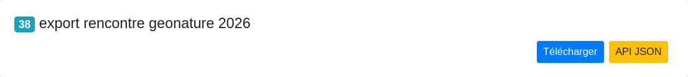
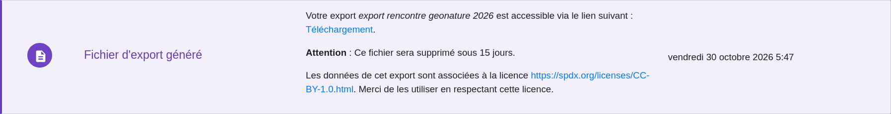
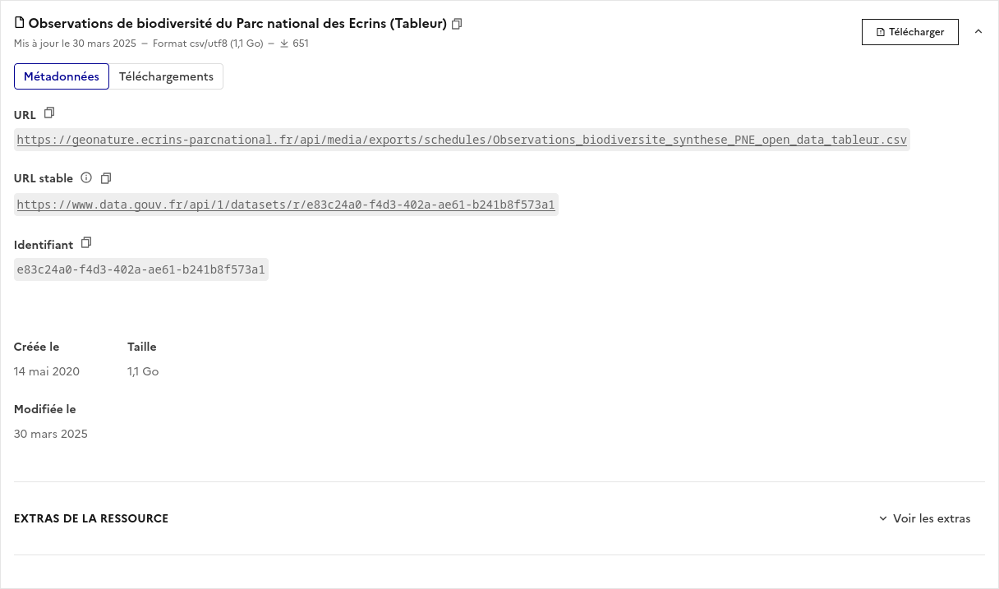
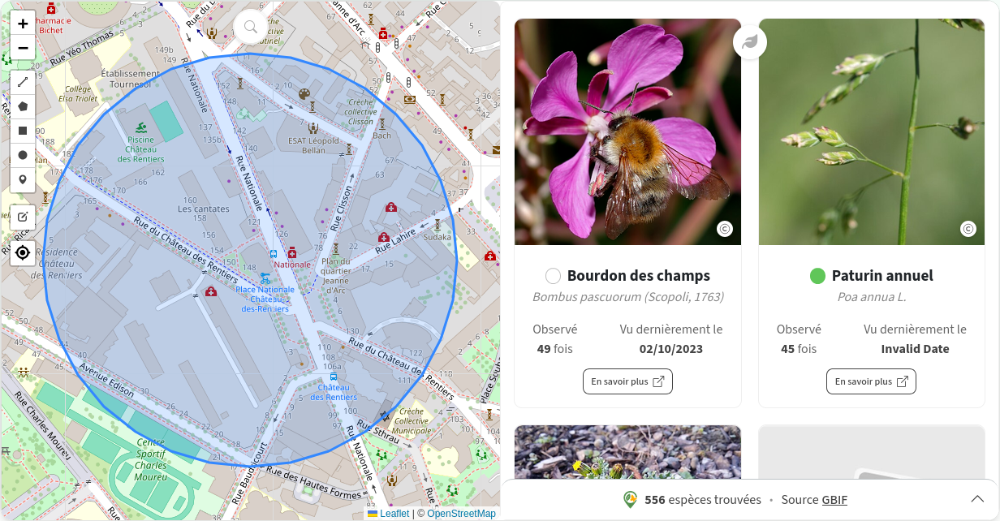

# Atelier Connexion d'une application avec GeoNature

Dans cet atelier, l'objectif est de montrer quelles sont les différentes entrées pour récupérer (de manière dynamique) et saisir des données dans GeoNature et les valoriser dans une application.

## Objectif de l'atelier

Dans les 1h30-2h d'atelier, nous vous proposons de manipuler les différents points d'entrée de données et produire des visualisations et des synthèses à partir de ces dernières.

Pour cela, nous vous proposons d'utiliser Streamlit pour sa simplicité d'utilisation avec un minimum de code ! Pour vous aider, nous proposons une application de base qui va vous permettre d'avoir un socle pour la création de graphiques, de formulaires utilisant l'API de GeoNature et même de créer des données sur GeoNature !

_Sachant que le public de cet atelier est mixte, nous vous proposons de former des groupes avec au moins une personne ayant des connaissances dans le langage Python._

## Préparer son environnement de développement

Comme vous l'avez peut-être deviné, nous allons nous appuyer sur le langage Python pour cet atelier !

### Installer `uv`

Il est d'usage dans Python de créer des environnements virtuels pour cloisonner les applications et leurs dépendances à certaines versions de librairies. Une des technologies récentes qui a fait ses preuves dans la communauté est `uv`.

Pour installer `uv`, je vous recommande la documentation officielle : https://docs.astral.sh/uv/getting-started/installation/

**Pour les utilisateurs de Windows** `uv` est compatible avec Windows, mais il est aussi possible de créer des environnements virtuels avec Anaconda.

### Créer un environnement virtuel et installer les librairies

Il suffit de lancer la commande `uv sync`.

Une fois terminée, lancez `uv run check_env.py` pour vérifier que l'environnement virtuel est bien installé !

### Configurer l'application avec son GeoNature

Pour donner accès à son GeoNature, l'application utilise un fichier de configuration `.streamlit/secrets.toml`.

Créez ce fichier en vous appuyant sur le squelette suivant :

```toml
# API GeoNature (api/web.py)
[geonature]
api_url = "https://demo.geonature.fr/geonature/api"
login = "admin"
password = "admin"

# Connexion à la base GeoNature (api/sql_queries.py : st.connection("sql"))
[connections.sql]
url = "postgresql+psycopg2://rencontres_gn:<mdp>@demo.geonature.fr:5437/geonaturedemodb"


```

### Lancement de l'app

Une fois votre configuration remplie, vous pouvez lancer l'application avec la commande suivante :

```sh
uv run streamlit run main.py
```

## Trois grands groupes d'accès aux données

L'accès aux données de GeoNature peut se diviser en trois grandes catégories :

- API
- Fichier
- SQL

### API

GeoNature est une application divisée en deux parties : (1) le _frontend_ : l'interface client, (2) le _backend_ (entre autres) qui s'occupe de retourner les données à l'interface pour que ces dernières soient affichées. On parle plus généralement d'API.

C'est cette dernière partie qui nous intéresse ! Cette API est utilisable à l'aide du protocole HTTP. Ce protocole d'échange de données est implémenté dans une large partie des langages de programmation mais aussi d'outils et de librairies d'analyse de données.

Par exemple, il est possible de récupérer la liste des cadres d'acquisition avec l'adresse suivante :

`/meta/acquisition_frameworks`

```json
{
  "has_next": true,
  "has_prev": false,
  "items": [
    {
      "acquisition_framework_desc": "Inventaire amphibiens, odonates et flore de zone humide avant et aprés travaux par struture GEMAPI du 82",
      "acquisition_framework_end_date": "2025-10-31",
      "acquisition_framework_name": "AAP Entente sur l'Eau Restauration de ZH en tête de BV 82",
      "acquisition_framework_parent_id": null,
      "acquisition_framework_start_date": "2021-01-01",
      "additional_data": {
        "test number": 0
      },
      "cor_af_actor": [
        {
          "id_acquisition_framework": 58,
          "id_cafa": 82,
          "id_nomenclature_actor_role": 363,
          "id_organism": 14,
          ...
        }
      ]
    },
    ...
  ]
}
```

Dans une requête, il est possible d'ajouter des paramètres pour filtrer les données.

### Export

Un des points d'entrée les plus utilisés est le module Export. Ce dernier permet de définir une « vue », une table virtuelle qui permet de récupérer le résultat d'une requête utilisée fréquemment. Le grand avantage est d'avoir un point d'entrée de données complètement sur mesure pour la structure qui gère une instance de GeoNature.

Pour récupérer les données produites par cette vue dans le module Export, il y a deux possibilités.

#### Export - Fichier (statique)

La première possibilité consiste à récupérer un fichier statique contenant les données souhaitées parmi plusieurs formats de fichiers (csv, geojson, geopackage, shapefile).

De base, le module Export lance la génération du fichier de manière asynchrone lorsque l'utilisateur initie la demande depuis l'interface.



Une fois le fichier généré, une notification lui indiquera quand le fichier est prêt à être téléchargé.



Une deuxième manière consiste à générer des fichiers de manière périodique à l'aide des « exports planifiés ». Cela permet de régénérer le fichier contenant les données de l'export de manière périodique et surtout de le rendre accessible depuis une URL. Dans le cas du parc national des Ecrins, cette URL est le point d'entrée vers ces données d'observations sur [data.gouv.fr](https://www.data.gouv.fr/datasets/observations-de-biodiversite-faune-flore-du-parc-national-des-ecrins)



<!-- Le parc amazonien de Guyane utilise cette méthode pour peupler son LizMap. -->

#### Export - API

Cette première possibilité d'export est intéressante mais ne permet pas de profiter de l'évolution de la données en temps-réel ! Pas de panique !
lorsque vous créer un export, ce dernier est rendu accessible dans une API accessible depuis l'adresse : `<URL_GEONATURE>/api/export/<ID_EXPORT>`.
Pour cet atelier, nous avons créer un export avec les données de l'ARB autour du Totem : `https://demo.geonature.fr/geonature/api/exports/api/38`

Des applications comme [BAM](https://github.com/PnX-SI/BAM-widget) utilisent cette API pour accéder aux données d'une instance de GeoNature.



### SQL

Si tout a échoué dans votre quête pour récupérer les données par l'API ou par l'export, alors il vous reste... à faire vos propres requêtes sur la base de données PostgreSQL de GeoNature.

## Streamlit

Pour développer votre dashboard, nous vous proposons un framework simple d'utilisation : [Streamlit](https://streamlit.io/). Ce framework a pour avantage de proposer une programmation simple et très haut-niveau. Par exemple, ce code suffit à afficher un formulaire pour calculer la distance entre deux coordonnées :

```python
import streamlit as st
from geopy.distance import geodesic


st.header("Application de calcul de distance géodésique")
col1, col2 = st.columns(2)

with col1:
    st.subheader("Premières coordonnées")
    lon1 = st.number_input("lon1")
    lat1 = st.number_input("lat1")
with col2:
    st.subheader("Deuxièmes coordonnées")
    lon2 = st.number_input("lon2")
    lat2 = st.number_input("lat2")
distance_km = None

if lon1 and lat1 and lon2 and lat2:
    distance_km = geodesic((lon1, lat1), (lon2, lat2))

st.header("Résultat")
if distance_km:
    st.write(f"Distance entre les deux coordonnées {distance_km}")
else:
    st.write("Indiquer des coordonnées")
```

`streamlit` est construit autour de méthodes permettant de faire des choses simples avec le moins de lignes de code possible. Dans l'exemple ci-dessus :

- `st.write` affiche du texte
- `st.number_input` crée un champ pour saisir un nombre et le stocke dans la variable associée. **Si une valeur d'un formulaire est modifiée, alors l'ensemble du code qui utilise les variables associées (ici, `lon1, lon2, lat1, lat2`) se relance.**
- `st.subheader` crée un sous-titre et `st.header` crée un titre.
- `st.columns(n)` crée `n` colonnes

Pour plus d'informations, rendez-vous sur la doc de [**Streamlit** ](https://docs.streamlit.io/develop/api-reference)

Pour plus d'informations, rendez-vous sur la doc de [**Streamlit** ](https://docs.streamlit.io/develop/api-reference)

> [!NOTE]
> Dans ce tutoriel, nous utilisons **Streamlit** pour sa simplicité et la rapidité de mise en place de POCs. Il existe toutefois plusieurs technologies, chacune avec ses avantages et inconvénients, permettant de faire de la visualisation de données. Pour n'en citer qu'une infime partie :
>
> -  **Dash** : framework Python spécialisé dans la création d'applications web de type dashboard. Il s'appuie principalement sur Plotly, une librairie permettant de générer des graphiques interactifs. <https://dash.plotly.com/>
> -  **RShiny** : framework de création de dashboards bien connu de la communauté R. Très puissant, stable et supporté par les créateurs de R. <https://shiny.posit.co/>
> -  **Grafana** : outil de monitoring qui permet aussi de créer des dashboards. Il est possible de créer des graphiques à partir de données provenant d'API. À la différence des précédents, il ne demande pas de « coder » : les dashboards se construisent uniquement à l'aide d'une interface. <https://grafana.com/>
> -  **Gradio** : framework d'interfaces web plus orienté vers la connexion à des modèles de machine learning, deep learning, etc. <https://gradio.app/>
> - Autres : [Observable](https://observablehq.com/) (équivalent notebook 100 % JS, uniquement utilisable en ligne), [Flet](https://flet.dev/)

### Ensemble de fonctions fournies

Vous trouverez dans le dossier `api`, un ensemble de fonctions Python pour récupérer des données sur votre instance GeoNature.

#### GeoNature Client

`api/web.py` définit `GeoNatureClient` : URL de l'API, authentification (`st.secrets["geonature"]`) et appels HTTP. Une instance partagée s'obtient avec `get_client()`.

| Méthode                                             | Route                                              | Usage                       |
| --------------------------------------------------- | -------------------------------------------------- | --------------------------- |
| `get_observations(limit, query_params, **filters)`  | `POST /synthese/for_web`                           | Observations de la synthèse |
| `autocomplete_taxons(search_str, full)`             | `GET /taxhub/api/taxref/search/nom_valide/{texte}` | Recherche Taxref            |
| `get_nomenclatures(code_type)`                      | `GET /nomenclatures/nomenclature/{code_type}`      | Termes d'une nomenclature   |
| `get_default_nomenclatures(*code_types)`            | `GET /occtax/defaultNomenclatures`                 | Valeurs par défaut Occtax   |
| `add_releve(payload)`                               | `POST /occtax/releve`                              | Création d'un relevé        |
| `get_data_from_export(id_export, limit, **filters)` | `GET /exports/api/{id_export}`                     | Données d'un export         |

Pour une autre route : `get_client().get(chemin)` ou `.post(chemin, json=...)` (le jeton est ajouté automatiquement).

```python
from api.synthese import load_observations
from api.occtax import add_observation
from api.export import load_data_from_export

gdf = load_observations(100, {}, cd_ref=[60612])  # GeoDataFrame, filtres de la synthèse

gdf = load_data_from_export(38, nom_valide="Lynx lynx")  # GeoDataFrame, filtres en query string

add_observation(cd_nom=60612, nom_cite="Lynx lynx", lat=44.9, lon=6.3, id_dataset=1)
```

> [!WARNING]
> `add_observation` écrit réellement dans GeoNature : vérifiez l'instance et le `id_dataset`.

#### Requête SQL

`api/sql_queries.py` interroge directement PostgreSQL via `st.connection("sql")` (configuré dans `.streamlit/secrets.toml`, section `[connections.sql]`).

```python
conn = st.connection("sql")
df = conn.query("select * from gn_synthese.synthese limit :limit", params={"limit": 50})
```

Requêtes fournies : `last_observations_taxonomy(limit)` et `new_species(date)`. Tables clés : `gn_synthese.synthese` et `taxonomie.taxref`, reliées par `cd_nom`.

> [!WARNING]
> Utilisez un compte en lecture seule et des paramètres (`:limit`) plutôt que d'interpoler du texte (injection SQL).

### Widget mis à disposition

Pour ne pas perdre de temps sur les formulaires, le dossier `widget/` contient deux composants Streamlit prêts à l'emploi. Ils appellent l'API de GeoNature/TaxHub via le client défini dans `api/web.py`.

#### Nomenclature

`nomenclature_input` (dans `widget/nomenclature.py`) affiche une liste déroulante avec recherche sur les termes d'un type de nomenclature GeoNature (ex : `SEXE`, `STATUT_BIO`).

```python
from widget.nomenclature import nomenclature_input

id_sex = nomenclature_input("SEXE", "Sexe")
```

- `code_type` : code du type de nomenclature (ex : `"SEXE"`).
- `label` : libellé affiché au-dessus du champ (par défaut, le `code_type`).
- `session_key` : clé Streamlit du widget (par défaut `nomenclature_<code_type>`). À préciser si vous utilisez deux fois le même type sur la page.
- **Retourne** l'`id_nomenclature` du terme choisi, ou `None` si rien n'est sélectionné.

Les termes proviennent de la route `/nomenclatures/nomenclature/{code_type}`.

#### Recherche de taxon

`taxref_input` (dans `widget/taxon.py`) affiche un champ de recherche avec autocomplétion sur Taxref (via TaxHub, route `/taxhub/api/taxref/search/nom_valide/{texte}`). Il s'appuie sur la librairie `streamlit_searchbox`.

```python
from widget.taxon import taxref_input

cd_ref = taxref_input("cd_ref")                    # -> cd_ref (int) ou None
taxon = taxref_input("taxon_add", full=True)       # -> {"nom_valide": ..., "cd_nom": ...} ou None
```

- `session_key` : clé Streamlit du widget (par défaut `"cd_nom"`). Elle doit être unique par widget sur la page.
- `full` : si `False` (défaut), retourne le `cd_ref` du taxon, pratique pour filtrer la synthèse (`{"cd_ref": [cd_ref]}`). Si `True`, retourne un dictionnaire avec `nom_valide` et `cd_nom`, nécessaire pour ajouter une observation.

> [!NOTE]
> Ces deux widgets sont déjà utilisés dans `main.py` :
> `taxref_input` pour filtrer les observations sur la carte et
> pour choisir le taxon d'une nouvelle observation,
> `nomenclature_input` pour choisir le sexe.
